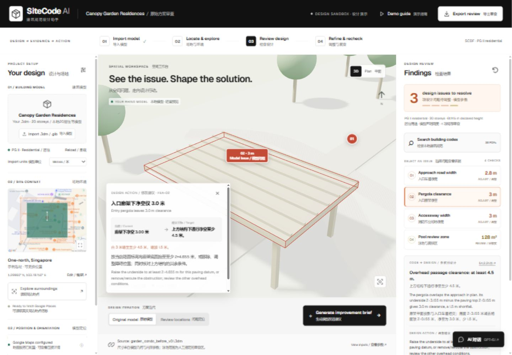

# SiteCode AI · 建筑规范设计助手

A bilingual design-review demonstration using the supplied **garden_condo_before_v01.3dm**: Canopy Garden Residences, a fictional, intentionally deficient residential case. The browser displays a lightweight GLB derived from the Rhino model's cached meshes, with findings linked to actual source-object UUIDs.

中英双语设计审查演示，使用提供的 **garden_condo_before_v01.3dm**。Canopy Garden Residences 为虚构、刻意设置问题的住宅案例；浏览器显示由 Rhino 缓存网格转换的轻量 GLB，检查标记关联原始模型对象 UUID。



## Authors & co-creators · 作者与共创者

Co-created by [@churi919](https://github.com/churi919) and [@Jacksonwang0913](https://github.com/Jacksonwang0913).

由 [@churi919](https://github.com/churi919) 与 [@Jacksonwang0913](https://github.com/Jacksonwang0913) 共同创作。

Author list / 作者名单：[AUTHORS.md](AUTHORS.md).

## Start · 启动

Right-click **Start-Demo.ps1 → Run with PowerShell**. It starts the local server and opens `http://127.0.0.1:4173`. If scripts are blocked, run the following in this folder, then open that address:

右键 **Start-Demo.ps1 → 使用 PowerShell 运行**，即可启动服务并打开浏览器。如脚本被限制，在此文件夹运行以下命令，再打开上述地址：

```powershell
node server/local.mjs
```

Node.js 20 or later and a browser with WebGL are required; no dependency installation is needed for the local demo. On Windows, the launcher looks for Node.js on your PATH and optionally a local Codex runtime. On macOS/Linux, run the command above from a terminal.

需要 Node.js 20 或以上，以及支持 WebGL 的浏览器；本地演示无需安装项目依赖。Windows 启动器会优先查找系统 Node.js，也可识别本机的 Codex 运行环境。macOS/Linux 用户可在终端中运行上述命令。

The repository does **not** include an OpenAI key or a shared AI account. To enable live AI, configure **your own API key** as described below. The local model, review findings and code search can be explored before adding any keys.

仓库**不附带 OpenAI 密钥或共享 AI 账号**。如需启用实时 AI，请按下文接入**自己的 API 密钥**。未配置密钥时也可查看本地模型、检查结果和规范检索。

## Features · 功能

- **3D model review:** orbit, zoom, plan view, issue markers, source-object highlighting, and import of `.3dm` / `.glb` geometry. / **三维模型审查：**旋转、缩放、平面视图、问题标记、原始对象高亮，以及 `.3dm` / `.glb` 几何导入。
- **Site and orientation:** choose a site, draw a parcel, move the building and change its direction; map imagery and nearby places are available with your Google API configuration. / **场地与朝向：**选择位置、绘制地块、移动建筑和调整方向；接入自己的 Google API 后可查看地图及周边地点。
- **Code evidence:** local keyword/clause search, document and PDF-page references, selected excerpts, and source-linked rule summaries. / **规范依据：**本地关键词与条款检索、文件及 PDF 页码引用、选中摘录，以及带来源的规则摘要。
- **Source-grounded bilingual AI:** ask different code/design questions, inspect the evidence supplied to the model, keep follow-up context or start a new conversation. / **依据规范的双语 AI：**询问不同规范及设计问题、查看传给模型的依据、连续追问或开始新对话。
- **AI-to-model actions:** click a known `FEA-01`–`FEA-04` issue in an answer or its action card to fly to and highlight the exact model object, with current/target values and specific modification advice. Return to the chat without losing the answer. / **回答与模型联动：**点击回答中的已知 `FEA-01`–`FEA-04` 问题编号或问题卡片，自动定位并高亮精确模型对象，显示当前值、目标值及具体修改建议；返回聊天时保留原回答。
- **Presentation outputs:** generate an AI improvement brief when configured and export the review for discussion. / **展示输出：**配置后可生成 AI 改进建议，也可导出检查记录供讨论。

## Presentation flow · 展示流程

1. **Inspect the supplied model / 查看提供的模型** — Orbit the 20-storey garden condominium or switch to Plan. The model declares PG II residential use and a synthetic habitable height of approximately 61.145 m. / 旋转查看 20 层花园公寓，或切换平面视图。模型声明为用途组别 II 住宅，模拟居住高度约 61.145 米。
2. **Select a finding / 点击检查项** — Three selected criteria are flagged: access road **2.8 m vs 4 m**, pergola clearance **3.0 m vs 4.5 m**, and accessway width **3.0 m vs 7 m**. Select each marker to locate the corresponding model object and inspect the source. / 三项所选指标被标记：消防通道净宽 **2.8 米对 4 米**、廊架净空 **3.0 米对 4.5 米**、作业通道宽度 **3.0 米对 7 米**。点击标记定位相应模型对象并查看依据。
3. **Distinguish review evidence / 区分待核查证据** — The pool overlaps a manually nominated review envelope by **128 m²**. This is a review candidate, not an automatic compliance failure or a derived compliant route. / 泳池与人工指定的审查范围重叠 **128 平方米**。此项为待核查候选问题，不是自动判定的违规或推导出的合规路线。
4. **Search and locate a source / 检索与定位来源** — Search the local corpus of **38 PDFs and 3,590 pages**, or browse the curated source-linked clauses. Search by keyword or clause number, open the PDF page, and mark a relevant model location where evidence is available. / 检索包含 **38 份 PDF、3,590 页**的本地资料库，或浏览精选条款。按关键词或条款号查询，打开对应 PDF 页，并在有位置证据时定位模型。
5. **Discuss and locate / 与 AI 讨论并定位** — After configuring your own OpenAI key, open the floating chat entry at the **bottom right** and ask “Which clauses does our model fail?” Click an `FEA` issue number or action card in the answer: the camera moves to the corresponding object and a bilingual action panel appears. For example, `FEA-02` shows **3.0 → 4.5 m clearance, +1.5 m**, with a recommended pergola underside of **Z=4.655 m** at the demo paving datum. / 接入自己的 OpenAI 密钥后，点击**右下角悬浮聊天入口**询问“我们不符合的具体条款是哪些？”点击回答中的 `FEA` 编号或问题卡片，镜头将定位相应对象并显示双语修改建议。例如 `FEA-02` 显示净空 **3.0 → 4.5 米，增加 1.5 米**，并按演示路面基准建议将廊架底面抬至 **Z=4.655 米**。

Use [DEMO_SCRIPT.md](DEMO_SCRIPT.md) for a 90-second paired English–Chinese presentation.

90 秒中英对照讲稿见 [DEMO_SCRIPT.md](DEMO_SCRIPT.md)。

## Evidence and scope · 依据与范围

- **Model evidence:** dimensions and object identities come from explicit embedded metadata and native geometric bounds. PG II use, height datum and building applicability remain declared or synthetic assumptions requiring project review. / 尺寸与对象标识来自模型内嵌元数据和原生几何包围盒；用途组别、高度基准和建筑适用条件仍为申报或模拟假设，须结合项目核实。
- **Review scope:** the three selected criterion findings and one pool review candidate do not form a complete Fire Code assessment or approval. Improvement briefs contain recommendations; the demonstration does not generate revised building geometry. / 三项所选指标问题与一项泳池候选问题，不构成完整消防规范评估或审批。改进说明提供设计建议，演示不会自动生成修改后的建筑几何。
- **Sources:** keyword retrieval searches locally indexed PDF text; it is not a live whole-internet search. Preserve document ID, PDF page, version notes and effective dates when interpreting a result. Indexed documents are not independently verified as the current applicable versions. / 关键词检索针对本地索引的 PDF 原文，不是实时全网搜索。解释结果时须保留文档编号、PDF 页码、版本说明及生效日期；入库文件未经独立确认均为当前适用版本。
- **Location:** known source UUIDs support the active case's markers. Unknown hydrant positions or unmapped imported geometry need location evidence. / 当前案例依据已知原始 UUID 定位；未知消火栓位置或尚未关联的导入几何，须补充位置证据。
- **Site context:** Google map imagery and nearby places provide context. Other surrounding 3D buildings and user-drawn parcels are illustrative; road-match points do not establish surveyed fire access, cadastral boundaries or setbacks. / Google 地图与周边地点提供环境参考。其余三维周边建筑及手绘地块为示意；道路匹配点不代表实测消防通行条件、法定地籍或退界。

## Use your own APIs · 接入自己的 API

Create a local `.env` from `.env.example` **only if you do not already have one**, then fill in your own credentials. `.env` is ignored by Git. Keep keys in the server environment; do not paste them into browser code or commit them.

如本地尚无 `.env`，复制 `.env.example` 为 `.env`，再填入自己的密钥。Git 已忽略 `.env`。密钥仅配置在服务器环境中，不要写进浏览器代码或提交到仓库。

```dotenv
OPENAI_API_KEY=your_own_openai_api_key
OPENAI_MODEL=gpt-6.1-sol
GOOGLE_MAPS_API_KEY=your_own_google_maps_api_key
```

| Variable / 变量 | Purpose / 用途 |
| --- | --- |
| `OPENAI_API_KEY` | Your own OpenAI API key for live chat and improvement briefs. A key with access to the selected model is required. / 用于实时对话和改进建议的个人 OpenAI API 密钥，须具有所选模型的调用权限。 |
| `OPENAI_MODEL` | Model identifier sent to the OpenAI Responses API; defaults to `gpt-6.1-sol`. Change it to a compatible model available to your account if needed. / 发送给 OpenAI Responses API 的模型标识，默认 `gpt-6.1-sol`；如有需要，可改为自己账号可用且兼容的模型。 |
| `GOOGLE_MAPS_API_KEY` | Your own Google key for Maps Static API, Places API (New) and Roads API. Enable the services you intend to use in your Google project. / 用于 Maps Static API、Places API（新版）及 Roads API 的个人 Google 密钥；需在自己的项目中启用所用服务。 |
| `PORT` | Optional local port; defaults to `4173`. The PowerShell launcher opens the default port. / 可选本地端口，默认 `4173`；PowerShell 启动器打开默认端口。 |

Restart the local server after editing `.env`. You can configure OpenAI and Google independently. AI requests go from the server to OpenAI's Responses API with the relevant question, conversation context and retrieved evidence; numerical findings remain deterministic. Google requests also use server-side proxies.

修改 `.env` 后重启本地服务。OpenAI 与 Google 可分别配置。AI 由服务器将相关问题、对话上下文及检索依据发送至 OpenAI Responses API；数值检查仍由确定性逻辑完成。Google 请求同样通过服务器代理。

**Without API keys:** model viewing/import, parcel drawing and direction controls, existing screening findings and recommendations, local code search, issue selection/highlighting and review export remain available. Live AI replies/briefs require your OpenAI key; Google imagery, nearby-place and road requests require your Google key. External PDF links require network access. The app does not substitute canned AI answers for missing credentials.

**未配置 API 时：**仍可使用模型查看与导入、绘制地块及方向调整、已有筛查结果与修改建议、本地规范检索、问题选择与高亮，以及检查记录导出。实时 AI 回答及建议说明需接入自己的 OpenAI 密钥；Google 地图、周边地点及道路请求需接入自己的 Google 密钥。外部 PDF 链接需要网络连接。缺少密钥时，应用不会用固定模板冒充实时 AI 回答。

## Models and development · 模型与开发

The included case's `FEA` actions use the UUIDs and evidence in `dist/assets/garden-condo-review.json`. Importing another model displays its geometry, but does not automatically produce a validated code assessment or map old findings to the new model. Add measured project inputs and verified object/evidence mappings before linking new issues. AI suggestions do not modify geometry automatically.

内置案例的 `FEA` 联动使用 `dist/assets/garden-condo-review.json` 中的 UUID 与证据。导入其他模型可显示几何，但不会自动生成已验证的规范审查，也不会把旧问题强行关联到新模型。关联新问题前，需要补充实测项目参数及可靠的对象与证据映射。AI 建议不会自动修改几何。

```sh
npm start
npm test
```

`dist/` contains the browser application and bundled local assets; `server/` contains the local server and API proxies; `tests/` covers code-context routing and evidence-based issue actions. Local running does not require `npm run build`; the build command generates the optional Worker deployment artifact.

`dist/` 包含浏览器应用及本地资源；`server/` 包含本地服务器和 API 代理；`tests/` 检查规范问题路由及基于证据的问题联动。本地启动无需运行 `npm run build`；该命令用于生成可选的 Worker 部署产物。

Primary fire-access reference: [SCDF Fire Code 2023 §4.2](https://www.scdf.gov.sg/fire-safety-services-listing/fire-code-2023/table-of-content/chapter-4-site-planning-external-firefighting-provision/clause-4.2-provision-for-external-access-to-building-for-firefighting-and-accessibility-of-site-to-firefighting-appliances).
